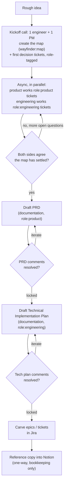

# ana-rfcs

This is where a rough idea turns into a locked PRD, a locked Technical Implementation Plan, and a set of implementation tickets — as GitHub issues, before anything moves to Jira or Notion. If you're an engineer or a PM picking up work here, this doc is "what do I do next," not a tutorial on the underlying tooling — for that, see the [`/wayfinder` skill reference](https://www.aihero.dev/skills-wayfinder).

## The process, end to end

1. **Kickoff call.** One engineer + one PM get on a call with the rough idea and run `/wayfinder`. Together they name the destination and create the **map** issue (label `wayfinder:map`), with its first batch of child decision tickets — each tagged `role:product` or `role:engineering` depending on whose call it is.
2. **Work the tickets, async.** From here, product and engineering each pick up their own labelled tickets on the map independently — no call needed, no waiting on each other. Whoever picks up a ticket assigns it to themselves, resolves it, comments the answer, and closes it. New tickets get added to the map as answers surface more open questions.
3. **Agree the map's settled.** Once both sides have worked through their tickets and are comfortable nothing major is still open, product drafts the **PRD** as a new issue (`documentation`, `role:product`), synthesizing the decisions.
4. **Review the PRD.** Comments land directly on the PRD issue. Iterate the PRD in place until there's nothing left to push back on — it's locked.
5. **Draft the tech plan.** Only once the PRD is locked, engineering writes the **Technical Implementation Plan** as a new issue (`documentation`, `role:engineering`), tracing each PRD point to a concrete build approach against the real codebase.
6. **Review the tech plan.** Same loop — comments, iterate in place, until it's locked.
7. **Carve out tickets.** With both documents locked, cut the actual epics/implementation tickets in Jira (or wherever engineering tracks build work) — not in this repo.
8. **Reference into Notion — one-way, after the fact.** Once everything above is settled here, copy or link the final PRD and tech plan into Notion for bookkeeping. Notion is a mirror of a decision already made in GitHub, never the other way around.

## Labels

| Label | Meaning |
|---|---|
| `wayfinder:map` | The map issue for a project |
| `wayfinder:grilling` / `wayfinder:prototype` / `wayfinder:research` / `wayfinder:task` | A decision ticket's type — see the [skill reference](https://www.aihero.dev/skills-wayfinder) for what each means day to day |
| `role:product` / `role:engineering` | Whose call a ticket, the PRD, or the tech plan is |
| `documentation` | A written PRD or Technical Implementation Plan, not a decision ticket |
| `needs-triage` / `needs-info` / `ready-for-agent` / `ready-for-human` / `wontfix` | For anything outside this flow (one-off bugs, requests) — see `docs/agents/triage-labels.md` |

PRs are not used here — everything above is an issue.

## Commands

Full mechanics (sub-issue wiring, blocking, frontier queries) are in `docs/agents/issue-tracker.md`; this is the cheat sheet for day to day:

| Action | Command |
|---|---|
| Claim a ticket | `gh issue edit <n> --add-assignee @me` |
| Resolve + close a ticket | `gh issue comment <n> --body "<answer>"` then `gh issue close <n>` |
| Add/remove a label | `gh issue edit <n> --add-label "..."` / `--remove-label "..."` |
| Read a ticket in full | `gh issue view <n> --comments` |
| List open tickets on a map | `gh issue list --state open --json number,title,labels,assignees` |

## Example

[**Save & resume life insurance applications**](../../issues/10) (#10) shows the shape of it in practice: decision tickets closed out into a [PRD](../../issues/21) and a [Technical Implementation Plan](../../issues/30), both still being revised as the last tickets settle. `gh issue view 10 --comments` to see it.

## Related repos

See `CLAUDE.md` § Related repos — sibling PolicyMe repos live under the same parent directory.
